# 01 — Diagram: Assessment 2 — Practice Manifesto (structure)

- **Assessment:** `../../02-assessment-tasks/assessment-2-brief.md` — 10-point manifesto (5 maintain/refine + 5 change), ~2,000 words, one coherent position
- **Date:** 2026-09-15 (**v03**). v01 (2026-09-06) was AI-heavy in 6 of 10 points. v02 (2026-09-11) rewrote every point around "responsibility without authority" and was reverted — too abstract for several points. v03 restores v01's simpler master position; the responsibility/authority language now names only Points 8 and 9, where it's the actual explanation.
- **Layout:** hybrid / composite-layered — a **radial hub** (the overarching position), a **two-wing split** (MAINTAIN/REFINE ↔ CHANGE) with the 10 points as leaf nodes, a shared **method spine** (CURRENT CONDITION → POSITION → MECHANISM → ACTOR → ACTION → CONSEQUENCE) applied to every point, and an **ACTORS & INSTRUMENTS** zone that every point cross-links into. Cross-links are relationship claims (this point acts through that instrument), not flow.
- **Style:** `../../08-diagram-style/STYLE_GUIDE.md`
- **Sources scoped:** `00-reengineering-from-a1.md`, `../assessment-1/`, `../synthesis/01-master-map.md`, `../../03-weekly-resources/week-06/`, `../../03-weekly-resources/week-07/`. No unsourced claims — every point traces to an A1 cluster or a Week 6/7 note.
- **This is the thinking draft.** The baked A1-style version is made by editing the `CONTENT DATA` block of `../assessment-1/stigmergy-generator.py` — see `README.md`.

## Legend

| Element | Meaning |
|---------|---------|
| 🟡 Hub | The overarching position (one sentence) |
| 🟢 MAINTAIN/REFINE point | A mechanism that works — defend or tune it |
| 🔵 CHANGE point | A mechanism that should change substantially |
| ⬜ Method step | One of the 6 per-point questions |
| 🟥 Actor / instrument | Who acts, through what |
| **→** solid | Primary structure (hub → wing → point) |
| **- - →** dashed | "acts through" / "answers to" (point → actor/instrument) |
| **···→** dotted | Tension / feedback between points |

## Diagram

```mermaid
flowchart TB
  classDef default fill:#ffffff,color:#1a1a1a,stroke:#999999,stroke-width:1px;
  classDef hub fill:#F4D35E,color:#1a1a1a,stroke:#8a6c1f,stroke-width:2px;
  classDef keep fill:#8FBF8F,color:#1a1a1a,stroke:#3f5a3f,stroke-width:1px;
  classDef change fill:#9EC1D9,color:#1a1a1a,stroke:#345070,stroke-width:1px;
  classDef actor fill:#E07A5F,color:#1a1a1a,stroke:#7a3b28,stroke-width:1px;
  classDef method fill:#f2efe6,color:#1a1a1a,stroke:#b9a06a,stroke-width:1px;

  subgraph LEGEND["Diagram Key"]
    direction LR
    Kk1[Hub / position] --- Kk2[Maintain/refine]
    Kk2 --- Kk3[Change]
    Kk3 --- Kk4[Actor / instrument]
  end
  class Kk1 hub
  class Kk2 keep
  class Kk3 change
  class Kk4 actor

  HUB{"OVERARCHING POSITION (draft):\nCollective, accountable mechanisms work\nand must be defended. What's failing is\nwho decides the value of the profession's\nknowledge, innovation and labour — shown\nsharpest in procurement and conditions"}
  class HUB hub

  subgraph METHOD["Per-point method spine — applied to ALL 10 points [linear]"]
    direction LR
    MS1["CURRENT\nCONDITION"] --> MS2["POSITION\n(keep/refine/change)"] --> MS3["MECHANISM\n(instrument / pathway)"] --> MS4["ACTOR"] --> MS5["ACTION"] --> MS6["CONSEQUENCE\n(+ tension)"]
  end
  class MS1,MS2,MS3,MS4,MS5,MS6 method

  subgraph KEEP["MAINTAIN / REFINE — mechanisms that work [wing]"]
    direction TB
    P1["1 · Registration as a trust\nthreshold — keep APE interview\n+ PI insurance; refine so\nsupervision is real"]
    P2["2 · Duty to the public over the\npaying client — keep Architects\nAct s.17-18 + duty to withdraw"]
    P3["3 · Independent per-project\nsign-off — keep Building\nSurveyor / Council checkpoints"]
    P4["4 · Split apparatus + the\nbodies that turn experience\ninto evidence — keep; fund\nUAW/Parlour"]
    P5["5 · Open, amendable codes\n(NCC/AS) + CPD as formative\njudgement + commercial literacy"]
  end
  class P1,P2,P3,P4,P5 keep

  subgraph CHG["CHANGE — mechanisms that should change [wing]"]
    direction TB
    P6["6 · Stop privatising professional\nknowledge — limit the Standards\nAustralia → SAI Global pattern;\nkeep code-feeding research open"]
    P7["7 · Rule-making transparency —\nwho amends codes/standards, and\nthe overlapping schools/Institute/\nBoard leadership, made visible"]
    P8["8 · Procurement must not split\nresponsibility from authority —\na strengthened Deed of Novation,\nstandard in gov work"]
    P9["9 · Working conditions need a\ncollective instrument — not\nindividual resilience or escape"]
    P10["10 · Claim authority over where\nthe value of the work goes —\nfee transparency; decide where\nefficiency gains land"]
  end
  class P6,P7,P8,P9,P10 change

  subgraph ACTORS["ACTORS & INSTRUMENTS — every point cross-links here [network]"]
    direction TB
    A_ARBV["ARBV — registration, Code of\nConduct, CPD, discipline"]
    A_AACA["AACA — NSCA competencies,\nAPE, national coordination"]
    A_AIA["AIA / Parlour / ArchiTeam /\nArchitects Declare — advocacy,\nguidance, shared resources"]
    A_ACT["Architects Act 1991 + Regs\n(s.17-18 duty to public)"]
    A_NCC["NCC / Australian Standards /\nStandards Australia (now SAI Global)"]
    A_PROC["Procurement instruments —\nAS4000 / AS4902, Code + Deed\nof Novation, gov tender rules"]
    A_GOV["Government / VBA / OVGA —\nprocurement conditions,\npolicy, funding"]
    A_UNI["Universities — accreditation,\nsupervised experience, research"]
    A_PRAC["Practices — QA, mentoring,\nemployment conditions"]
    A_WORK["Fair Work + the award —\nUAW (workers) vs ACA (employers)\nargue here; not the same interest"]
    A_RES["Wellbeing of Architects research —\nthe evidence base on conditions"]
  end
  class A_ARBV,A_AACA,A_AIA,A_ACT,A_NCC,A_PROC,A_GOV,A_UNI,A_PRAC,A_WORK,A_RES actor

  %% structure
  HUB -->|coheres| KEEP
  HUB -->|coheres| CHG
  METHOD -.->|"tested against\nevery point"| KEEP
  METHOD -.->|"tested against\nevery point"| CHG

  %% points act through instruments (dashed = "acts through / answers to")
  P1 -.-> A_AACA
  P1 -.-> A_ARBV
  P2 -.-> A_ACT
  P3 -.-> A_GOV
  P4 -.-> A_AIA
  P4 -.-> A_ARBV
  P5 -.-> A_NCC
  P5 -.-> A_ARBV
  P6 -.-> A_NCC
  P6 -.-> A_GOV
  P7 -.-> A_ARBV
  P7 -.-> A_AIA
  P8 -.-> A_PROC
  P8 -.-> A_GOV
  P9 -.-> A_WORK
  P9 -.-> A_PRAC
  P9 -.-> A_ARBV
  P10 -.-> A_PROC
  P10 -.-> A_AIA
  P4 -.-> A_RES
  P4 -.-> A_WORK

  %% cross-point tensions (dotted)
  P1 -.->|"registration assumes real\nsupervision; supervision assumes\nP9's conditions"| P9
  P1 -.->|"an architect with no authority\non site cannot supervise"| P8
  P2 -.->|"duty to public is the test\nfor P8's design-authority claim"| P8
  P2 -.->|"duty of care extends to the\npeople producing the building"| P9
  P5 -.->|"commercial literacy is what lets\nan architect exercise P10's claim"| P10
  P5 -.->|"open codes depend on\nresisting P6's privatisation"| P6
  P6 -.->|"paywalled standards and opaque\ncommittees are the same gate"| P7
  P8 -.->|"unfixed after 20 years of\nadvocacy; needs P9's instrument"| P9
  P9 -.->|"conditions and fee economics are\ntwo sides of the same pressure"| P10
  P4 -.->|"the evidence base P9 argues\nfrom, but with no power"| P9

  style LEGEND fill:#f7f6f2,stroke:#999999,color:#1a1a1a
  style METHOD fill:#f2efe6,stroke:#b9a06a,color:#1a1a1a
  style KEEP fill:#E6F2E6,stroke:#6b9b6b,stroke-width:2px,color:#1a1a1a
  style CHG fill:#E7EDF2,stroke:#5b7c99,stroke-width:2px,color:#1a1a1a
  style ACTORS fill:#F2E4DE,stroke:#7a3b28,stroke-width:2px,color:#1a1a1a
```

## Key links to say aloud

1. **The hub is one sentence and everything hangs off it.** If a point doesn't serve the overarching position, it's one of "10 interesting issues" the brief warns against — cut or reframe it.
2. **Two wings, deliberately balanced 5 + 5.** The left wing (green) is what the profession already does well — mostly A1's registration/ethics/review clusters. The right wing (blue) is A1's under-guarded gates plus Week 6/7's value-capture, procurement and labour material.
3. **The method spine is applied to every point, not drawn once per point.** Each manifesto paragraph walks CURRENT CONDITION → POSITION → MECHANISM → ACTOR → ACTION → CONSEQUENCE. The diagram shows it once; `02-manifesto-skeleton.md` runs it ten times.
4. **Every point must land on a real actor and instrument** (the red zone). "The profession should…" is not an action; "the Victorian government mandates the Deed of Novation on public projects" is.
5. **The dotted cross-links are the coherence test** — point 1's registration depends on point 9's conditions and point 8's authority on site; point 5's commercial literacy is what lets point 10's claim be exercised; point 2's duty-to-public is the test for point 8 and extends into point 9. That interdependence is what makes it a manifesto, not a list.
6. **Where "responsibility without authority" lives:** named explicitly only in Points 8 and 9 — the two cases where it's the actual explanation (novation removes authority by contract alone; individuals carry responsibility for a structural condition they can't fix). Elsewhere the manifesto stays in plainer "collective mechanism" language.
7. **Where AI sits:** three single-line mentions only (Points 3, 6, 10), never the subject. See `02-manifesto-skeleton.md` §"Where AI sits".
8. **Direction / "so what":** architecture's *collective* mechanisms are sound; the decision over who captures the value of its knowledge, innovation and labour is being individualised and privatised — reform should move that decision back into collective, accountable hands.

## Version

- **v01 (2026-09-06)** — structure only, AI-heavy in 6 of 10 points.
- **v02 (2026-09-11)** — rewrote every point around "responsibility without authority"; reverted 2026-09-14 (too abstract for several points).
- **v03 (2026-09-15)** — restores v01's simpler master position. "Responsibility without authority" now names only Points 8–9. Points 9–10 rebuilt on Week 7 (conditions; fee/labour value) rather than AI. New actors: Fair Work/UAW/ACA, Wellbeing of Architects research. The overarching position remains a *draft* for the student to accept, edit or replace. Next: student locks the position → port to `stigmergy-generator.py` CONTENT DATA → add `03/04/05` pack files for the Week 8 WIP.
