# 01 — Diagram: Assessment 2 — Practice Manifesto (structure)

- **Assessment:** `../../02-assessment-tasks/assessment-2-brief.md` — 10-point manifesto (5 maintain/refine + 5 change), ~2,000 words, one coherent position
- **Date:** 2026-09-11 (**v02** — spine changed to *responsibility without authority*; Week 7 integrated; AI demoted from subject to a cross-cutting stance. Position still not locked by the student.)
- **Layout:** hybrid / composite-layered — a **radial hub** (the overarching position), a **two-wing split** (MAINTAIN/REFINE ↔ CHANGE) with the 10 points as leaf nodes, a shared **method spine** (CURRENT CONDITION → POSITION → MECHANISM → ACTOR → ACTION → CONSEQUENCE) applied to every point, and an **ACTORS & INSTRUMENTS** zone that every point cross-links into. Cross-links are relationship claims (this point acts through that instrument), not flow.
- **Style:** `../../08-diagram-style/STYLE_GUIDE.md`
- **Sources scoped:** `00-reengineering-from-a1.md`, `../assessment-1/`, `../synthesis/01-master-map.md`, `../../03-weekly-resources/week-06/`, `../../03-weekly-resources/week-07/`. No unsourced claims — every point traces to an A1 cluster or a Week 6/7 note.
- **This is the thinking draft.** The baked A1-style version is made by editing the `CONTENT DATA` block of `../assessment-1/stigmergy-generator.py` — see `README.md`.

## Legend

| Element | Meaning |
|---------|---------|
| 🟡 Hub | The overarching position (one sentence) |
| 🟢 MAINTAIN/REFINE point | A mechanism that works — defend or tune it |
| 🔵 CHANGE point | A mechanism that should change substantially |
| ⬜ Method step | One of the 6 per-point questions |
| 🟥 Actor / instrument | Who acts, through what |
| **→** solid | Primary structure (hub → wing → point) |
| **- - →** dashed | "acts through" / "answers to" (point → actor/instrument) |
| **···→** dotted | Tension / feedback between points |

## Diagram

```mermaid
flowchart TB
  classDef default fill:#ffffff,color:#1a1a1a,stroke:#999999,stroke-width:1px;
  classDef hub fill:#F4D35E,color:#1a1a1a,stroke:#8a6c1f,stroke-width:2px;
  classDef keep fill:#8FBF8F,color:#1a1a1a,stroke:#3f5a3f,stroke-width:1px;
  classDef change fill:#9EC1D9,color:#1a1a1a,stroke:#345070,stroke-width:1px;
  classDef actor fill:#E07A5F,color:#1a1a1a,stroke:#7a3b28,stroke-width:1px;
  classDef method fill:#f2efe6,color:#1a1a1a,stroke:#b9a06a,stroke-width:1px;

  subgraph LEGEND["Diagram Key"]
    direction LR
    Kk1[Hub / position] --- Kk2[Maintain/refine]
    Kk2 --- Kk3[Change]
    Kk3 --- Kk4[Actor / instrument]
  end
  class Kk1 hub
  class Kk2 keep
  class Kk3 change
  class Kk4 actor

  HUB{"OVERARCHING POSITION (draft):\nArchitecture makes individuals responsible,\nthen lets authority sit elsewhere.\nDefend the mechanisms where the two are\njoined; reform belongs where they have\nbeen separated"}
  class HUB hub

  subgraph METHOD["Per-point method spine — applied to ALL 10 points [linear]"]
    direction LR
    MS1["CURRENT\nCONDITION"] --> MS2["POSITION\n(keep/refine/change)"] --> MS3["MECHANISM\n(instrument / pathway)"] --> MS4["ACTOR"] --> MS5["ACTION"] --> MS6["CONSEQUENCE\n(+ tension)"]
  end
  class MS1,MS2,MS3,MS4,MS5,MS6 method

  subgraph KEEP["MAINTAIN / REFINE — responsibility and authority sit together [wing]"]
    direction TB
    P1["1 · Registration joins\nresponsibility to authority —\nkeep APE interview + PI insurance;\nrefine so supervision is real"]
    P2["2 · Duty to the public is\nauthority, not just obligation —\nkeep Act s.17-18 + the standing\nto withdraw"]
    P3["3 · Independent review\ndistributes authority on purpose —\nkeep Building Surveyor / Council;\nnobody checks their own work"]
    P4["4 · Split apparatus + the bodies\nthat give architects a voice on\nconditions — keep; refine by\nresourcing them"]
    P5["5 · Codes stay amendable\n(NCC/AS) + CPD builds the\njudgement registration assumes"]
  end
  class P1,P2,P3,P4,P5 keep

  subgraph CHG["CHANGE — responsibility has been separated from authority [wing]"]
    direction TB
    P6["6 · Knowledge we are held\nresponsible for knowing must not\nbe locked away — restore public\naccess to referenced standards"]
    P7["7 · If the rules bind us, we must\nsee who writes them — publish\ncommittee membership + interests;\nlimit cross-appointments"]
    P8["8 · Procurement must not split\ndesign responsibility from design\nauthority — a strengthened Deed of\nNovation, standard in gov work"]
    P9["9 · No individual can fix a\nstructural problem alone — a\ncollective instrument for fees,\nconditions and supervision"]
    P10["10 · Claim authority over where\nthe value of the work goes —\nfee transparency; decide where\nefficiency gains land"]
  end
  class P6,P7,P8,P9,P10 change

  subgraph ACTORS["ACTORS & INSTRUMENTS — every point cross-links here [network]"]
    direction TB
    A_ARBV["ARBV — registration, Code of\nConduct, CPD, discipline"]
    A_AACA["AACA — NSCA competencies,\nAPE, national coordination"]
    A_AIA["AIA / Parlour / ArchiTeam /\nArchitects Declare — advocacy,\nguidance, shared resources"]
    A_ACT["Architects Act 1991 + Regs\n(s.17-18 duty to public)"]
    A_NCC["NCC / Australian Standards /\nStandards Australia (now SAI Global)"]
    A_PROC["Procurement instruments —\nAS4000 / AS4902, Code + Deed\nof Novation, gov tender rules"]
    A_GOV["Government / VBA / OVGA —\nprocurement conditions,\npolicy, funding"]
    A_UNI["Universities — accreditation,\nsupervised experience, research"]
    A_PRAC["Practices — QA, mentoring,\nemployment conditions"]
    A_WORK["Fair Work + the award —\nUAW (workers) vs ACA (employers)\nargue here; not the same interest"]
    A_RES["Wellbeing of Architects research\n/ Parlour — the evidence base on\nconditions"]
  end
  class A_ARBV,A_AACA,A_AIA,A_ACT,A_NCC,A_PROC,A_GOV,A_UNI,A_PRAC,A_WORK,A_RES actor

  %% structure
  HUB -->|coheres| KEEP
  HUB -->|coheres| CHG
  METHOD -.->|"tested against\nevery point"| KEEP
  METHOD -.->|"tested against\nevery point"| CHG

  %% points act through instruments (dashed = "acts through / answers to")
  P1 -.-> A_AACA
  P1 -.-> A_ARBV
  P2 -.-> A_ACT
  P3 -.-> A_GOV
  P4 -.-> A_AIA
  P4 -.-> A_ARBV
  P5 -.-> A_NCC
  P5 -.-> A_ARBV
  P6 -.-> A_NCC
  P6 -.-> A_GOV
  P7 -.-> A_ARBV
  P7 -.-> A_AIA
  P8 -.-> A_PROC
  P8 -.-> A_GOV
  P9 -.-> A_WORK
  P9 -.-> A_PRAC
  P9 -.-> A_ARBV
  P10 -.-> A_PROC
  P10 -.-> A_AIA
  P4 -.-> A_RES
  P4 -.-> A_WORK

  %% cross-point tensions (dotted)
  P1 -.->|"registration assumes real\nsupervision; supervision assumes\nP9's conditions"| P9
  P1 -.->|"an architect with no authority\non site cannot supervise"| P8
  P5 -.->|"open codes depend on\nresisting P6's privatisation"| P6
  P2 -.->|"duty to public is the test\nfor P8's design-authority claim"| P8
  P6 -.->|"paywalled standards and opaque\ncommittees are the same gate"| P7
  P9 -.->|"fee economics set conditions;\nconditions are where fee\ncompetition lands"| P10
  P4 -.->|"the advocacy/research bodies\nare P9's evidence base"| P9

  style LEGEND fill:#f7f6f2,stroke:#999999,color:#1a1a1a
  style METHOD fill:#f2efe6,stroke:#b9a06a,color:#1a1a1a
  style KEEP fill:#E6F2E6,stroke:#6b9b6b,stroke-width:2px,color:#1a1a1a
  style CHG fill:#E7EDF2,stroke:#5b7c99,stroke-width:2px,color:#1a1a1a
  style ACTORS fill:#F2E4DE,stroke:#7a3b28,stroke-width:2px,color:#1a1a1a
```

## Key links to say aloud

1. **The hub is one question, asked ten times:** *does the person carrying the responsibility hold the authority to act on it?* If a point can't be stated as "X carries the responsibility; Y holds the authority," it's one of the "10 interesting issues" the brief warns against — cut or reframe it.
2. **The two wings are the answer to that question, not two topics.** Green = the two are joined, so defend the mechanism (A1's registration / ethics / review clusters). Blue = they have been separated, so that is where reform belongs (A1's under-guarded gates, plus Week 7's conditions and fee economics).
3. **This grows out of Assessment 1.** A1 found the profession polices its visible gate tightly and its invisible ones loosely — i.e. it mapped *where power is mismatched*. A2 judges each mismatch and proposes the repair. Every point names its A1 cluster.
4. **The method spine is applied to every point, not drawn once per point.** Each manifesto paragraph walks CURRENT CONDITION → POSITION → MECHANISM → ACTOR → ACTION → CONSEQUENCE. The diagram shows it once; `02-manifesto-skeleton.md` runs it ten times.
5. **Every point must land on a real actor and instrument** (the red zone). "The profession should…" is not an action; "the Victorian government mandates the Deed of Novation on public projects" is.
6. **The dotted cross-links are the coherence test** — point 1's registration depends on point 9's conditions and point 8's authority on site; point 5's open codes depend on point 6; point 4's research bodies are point 9's evidence base. That interdependence is what makes it a manifesto, not a list.
7. **Where AI sits:** nowhere as a point, deliberately. It is a cross-cutting stance — responsibility cannot be delegated to something that cannot be held accountable, so a tool assists production while the architect decides. It surfaces inside P3 (review), P6 (enclosure, one line) and P10 (where efficiency gains land). See `02-manifesto-skeleton.md` §"The AI stance".

## Version

- **v01 (2026-09-06)** — structure only, built on A1 + Week 6. Points 9 and 10 were AI points.
- **v02 (2026-09-11)** — spine changed to *responsibility without authority* (an extension of A1's power-mismatch finding rather than a new subject). Week 7 integrated: P4 gains the worker-voice/research bodies, P9 replaced with the collective instrument for conditions, P10 rewritten around where the value of the work goes. AI demoted to a cross-cutting stance and removed from P1/P4/P5 node text. New actors: UAW/ACA/Fair Work, Wellbeing of Architects research. The overarching position remains a *draft* for the student to accept, edit or replace. Next: student locks the position → port to `stigmergy-generator.py` CONTENT DATA → add `03/04/05` pack files for the Week 8 WIP.
