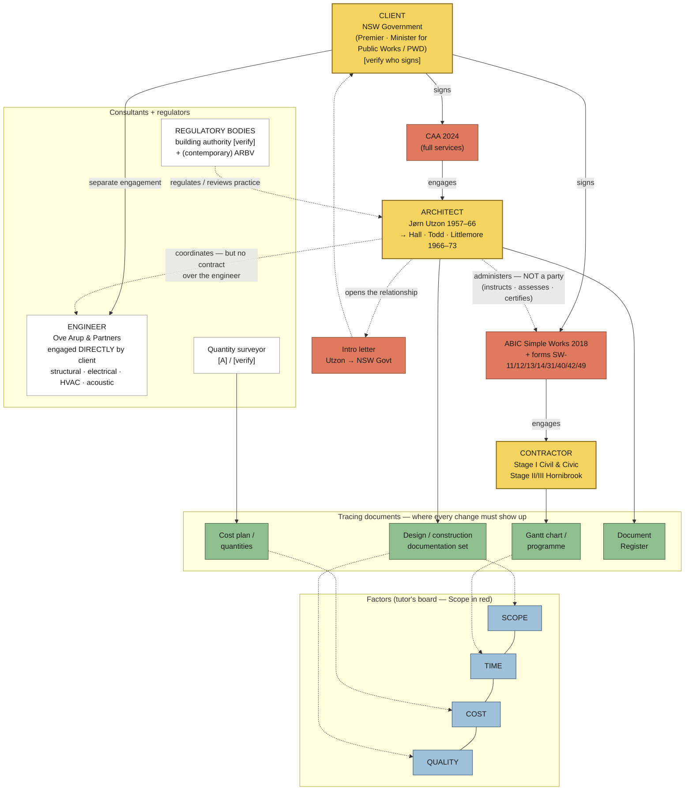

# 01 — Diagram: SOH parties, instruments and tracing documents

- **Assessment:** `../../02-assessment-tasks/assessment-3-brief.md`
- **Date:** 2026-09-26 (v01)
- **Layout:** hybrid — a **top→down contract triangle** (client / architect / contractor, with the instrument named on each edge), a **consultant + regulator** side zone, and a **tracing-documents strip** along the bottom that every change runs through. Built from the tutor's Miro clusters (`../../03-weekly-resources/week-09/miro-board-parties-instruments.jpg`).
- **Sources:** A3 brief; the SOH project-information extract shown in the brief's video still (Utzon engaged Mar 1957; Arup engaged directly by client; Stage I Civil & Civic; Stage II & III Hornibrook). Historical names/dates carry `[verify]` until checked against the supplied SOH PDF.
- **Style:** `../../08-diagram-style/STYLE_GUIDE.md`

## Legend

| Element | Meaning |
|---------|---------|
| 🟡 Party (contracting) | Signs a contract |
| ⬜ Party (non-contracting) | Acts in the project but isn't party to that contract |
| 🟥 Instrument | The contract / agreement / form |
| 🟢 Tracing document | Where a change shows up (cost, time, drawings) |
| **→** solid | Contractual relationship (named instrument) |
| **- - →** dashed | Administers / advises / coordinates (no contract between them) |
| **···→** dotted | Regulates / reviews |

## Diagram

## What the map makes visible

1. **The architect administers a contract they are not party to.** Under ABIC SW the contract is client ↔ contractor; the architect instructs, assesses and certifies. That's the *integrity, fairness and impartiality* duty the brief quotes from Architects Regulations 2015 reg 5.2 — the core Part B mechanism.
2. **The engineer was engaged directly by the client**, not through the architect. The architect coordinates a consultant they have no contract with — scenario 3's engineer-vs-architect conflict lives on this dashed line. (Link to A2: this is *responsibility without authority* in a concrete case — use only if it helps Part B, don't import the frame.)
3. **One event produces two change chains.** A redesign after construction starts changes the **construction contract** (SW-12 → SW-14 → SW-11 → SW-31) *and* the **architect's own services** (extra design work under the CAA — rubric C2). The file needs both. See `03-change-chain.md`.
4. **The client changed.** Cahill (d. 1959) → later premiers → Askin government 1965 with Davis Hughes as Minister for Public Works `[verify]`. A change of client representative is itself a change the file should record.

## Gaps

- Who signs for the client in our file (Premier? Minister? SOH Executive Committee?) — decide + declare `[A]`.
- Was there a QS on Stage I? `[verify]`
- Which building authority applies historically — or do we treat it contemporarily `[A]`?
