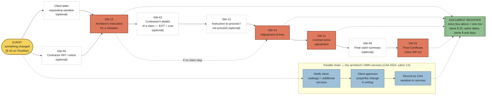

# 03 — Diagram: "Something changed" → the document chain

- **Date:** 2026-09-26 (v01)
- **Layout:** left→right **linear chain** (the construction-contract documents in order) with a parallel **CAA strip** underneath (the architect's own services changing) and the **factors** each document settles. This is the spine every scenario runs through; the choice of scenario only changes the content, not the chain.
- **Sources:** A3 brief (form list + order of optional forms). ABIC clause numbers are **not** given here — look them up in `SW-2018-ABIC_Contract-1.pdf` and the SW 2018 User Guide flowcharts, and add them in Week 11.

## The recurring question, decomposed

| Question | Answered by | Document |
|----------|-------------|----------|
| What changed? | Scope / time / cost / quality / responsibilities | Timeline row (E-ID) |
| Who initiated it? | Client · architect (design) · contractor (site) · engineer | Client letter / SW-40 / architect's decision |
| Who needed to respond? | Architect (instructs, assesses, certifies) · client (approves, pays) · contractor (quotes, claims) | SW-12 / SW-42 / SW-13 |
| What were the consequences? | Time, price, final amount | SW-14 · SW-11 · SW-31 |
| What must the architect **communicate**? | To the client, promptly (reg 5.2(c)) · to the contractor, fairly (reg 5.2(a)) | Letters + forms |
| What must the architect **record**? | Every step, dated, numbered | Document Register |

## Diagram

**Consistency rule the chain creates (rubric C4):** the days in SW-14, the $ in SW-11, and the amount in SW-31 must equal what's in the Timeline, the Register, the correspondence and Part B. Decide the numbers **once** (in a single "event sheet"), then copy them out.

## Scenario options — early read (the group decides at meeting #2)

| | S1 + S2 as a **connected series** (piers + column demolition) | S3 — hall ceilings (plywood → steel) |
|--|--|--|
| Root cause | Construction started (Mar 1959) **before the roof was designed**; the final roof needed more support than the podium was built for `[verify]` | Architect's integrated structural/acoustic plywood system vs engineer's alternative; later redesigned by Team II `[verify]` |
| Which architect | **Utzon** — the same architect who signs the intro letter and the CAA | Straddles **Utzon → Hall/Todd/Littlemore** (1966) — the file's "architect" changes mid-story |
| Contract fit | Clean "after construction commenced" variation to a built package (Stage I) — fits the SW-12 → 14 → 11 → 31 chain directly | Richer, but the change is partly design-stage (before the works) — harder to force through construction forms |
| Part B material | Informing the client of the risk of starting early (reg 5.2(c)); **assessing a claim fairly when the architect's own incomplete design caused it** (reg 5.2(a)); fees for the redesign (CAA) | Engineer engaged directly by client → coordination without contractual control; conflict between professional opinions; change of architect |
| Risk | May feel "simple" — needs good research on quantities, dates and cost | Messier coherence; more research; bigger C4 risk |

**Recommendation: S1 + S2 as one connected series**, with S3 researched as a backup. It keeps a single architect across letter → CAA → contract → forms, gives the cleanest chain for C1 and C4, and sets up the sharpest Part B tension (the architect must certify fairly on a claim arising from their own design gap). The brief explicitly allows "a connected series of events". Treat this as a proposal — the three scenario sheets should test it.
